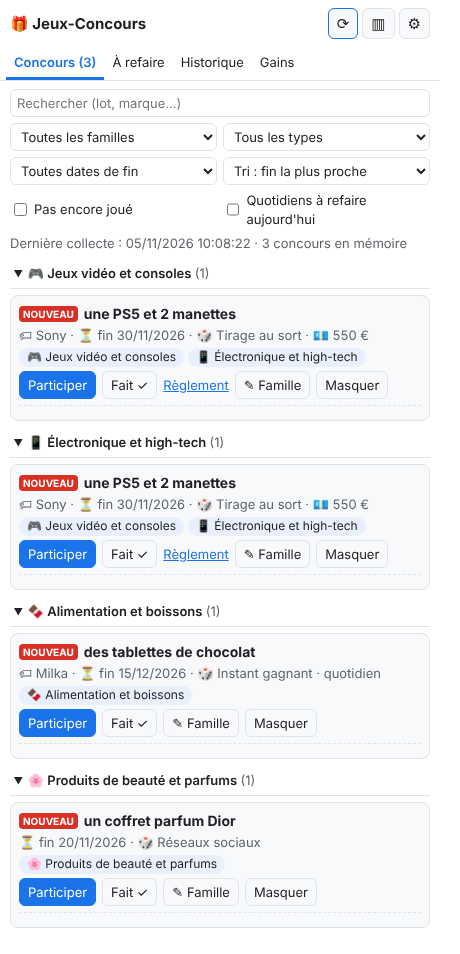
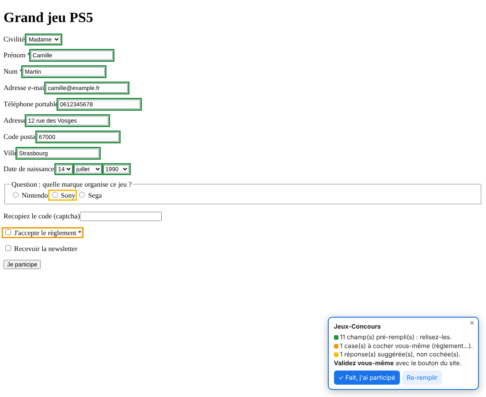

# 🎁 Jeux-Concours : assistant de participation (Chrome et Firefox)

Une extension de navigateur qui :

1. **trouve** les jeux-concours gratuits (annuaires, flux RSS, médias régionaux) une fois par jour ;
2. les **classe par famille** (jeux vidéo, high-tech, beauté, voyages…) ;
3. **écarte** les jeux payants (achat obligatoire, abonnement payant, numéro ou SMS surtaxé) ;
4. **pré-remplit** le formulaire quand vous cliquez sur « Participer » ;
5. **suit** vos participations, les concours quotidiens à refaire, les rappels et vos gains.

> **C'est toujours vous qui validez.** L'extension ne clique jamais sur « Valider / Je participe »,
> ne coche pas le règlement, ne touche pas aux CAPTCHA et ne gère qu'**un seul profil**.
> Les règlements interdisent la participation automatisée : vos gains restent valables.

| La liste par famille | Le formulaire pré-rempli (rien n'est envoyé) |
|---|---|
|  |  |

---

## Sommaire

1. [Comment ça marche (architecture)](#1-comment-ça-marche-architecture)
2. [Installer dans Chrome](#2-installer-dans-chrome)
3. [Installer dans Firefox](#3-installer-dans-firefox)
4. [Premier démarrage](#4-premier-démarrage)
5. [Utilisation au quotidien](#5-utilisation-au-quotidien)
6. [Le script Python (solution de secours)](#6-le-script-python-solution-de-secours)
7. [Lancer les tests](#7-lancer-les-tests)
8. [Modifier l'extension](#8-modifier-lextension)
9. [Limites connues](#9-limites-connues)

---

## 1. Comment ça marche (architecture)

```
                 1 fois par jour (robots.txt vérifié avant)
 Annuaires / RSS / médias ───────────────┐
                                         ▼
 Script Python (option) ──► background.js (arrière-plan de l'extension)
                              │  lib/collect.js    collecte (RSS d'abord, sinon lecture légère)
                              │  lib/pipeline.js   titre → lot, organisateur, valeur, date de fin, type
                              │  lib/analyze.js    exclusion des jeux payants
                              │  lib/categories.js classement par famille (mots-clés)
                              │  lib/dedupe.js     suppression des doublons
                              ▼
                     stockage local du navigateur (chrome.storage.local)
                              │        ▲
            ┌─────────────────┘        │ « Fait », gains, corrections de famille
            ▼                          │
   ui/panel.html (fenêtre / panneau latéral)
            │ « Participer »
            ▼
   onglet du concours ◄── content/prefill.js : remplit les champs vides,
                          surligne les cases à cocher par vous,
                          détecte la page « Merci pour votre participation »
```

**Rien n'est envoyé à un serveur** : votre profil, votre historique et vos gains restent dans le
navigateur. Les seules requêtes réseau sont la lecture des sources (sans cookies) et l'ouverture
des pages de concours que vous choisissez.

### Les fichiers

| Dossier / fichier | Rôle |
|---|---|
| `extension/manifest.json` | « carte d'identité » de l'extension (nom, permissions…) |
| `extension/background.js` | collecte quotidienne, badge, rappels, ouverture des concours |
| `extension/lib/` | toute la logique (testable sans navigateur) |
| `extension/ui/panel.*` | la fenêtre de l'extension (liste, filtres, historique, gains) |
| `extension/ui/options.*` | votre profil, les sources, les rappels, sauvegarde |
| `extension/content/prefill.js` | le pré-remplissage dans la page du concours |
| `python/collecteur.py` | script de secours qui alimente l'extension |
| `docs/SOURCES.md` | sources proposées et comment les vérifier |
| `tests/` | tests automatiques |

---

## 2. Installer dans Chrome

(Fonctionne aussi avec Edge, Brave, Opera et Vivaldi.)

### Étape 1 – Récupérer les fichiers

* **Sans rien installer** : sur la page GitHub du projet, cliquez sur le bouton vert **« Code »**
  puis **« Download ZIP »**. Faites un clic droit sur le fichier ZIP téléchargé →
  **« Extraire tout… »**. Choisissez un dossier où il restera (par ex. `Documents\jeux-concours`) :
  si vous le supprimez, l'extension disparaît.
* **Avec Git** (si vous l'avez installé) : `git clone <adresse du dépôt>`.

### Étape 2 – Activer le mode développeur

1. Ouvrez Chrome et tapez dans la barre d'adresse : `chrome://extensions` puis Entrée.
2. En haut à droite, activez l'interrupteur **« Mode développeur »**.

### Étape 3 – Charger l'extension

1. Cliquez sur **« Charger l'extension non empaquetée »** (en haut à gauche).
2. Sélectionnez le dossier **`extension`** (celui qui contient `manifest.json`), **pas** le
   dossier parent.
3. La carte « Jeux-Concours – assistant de participation » apparaît. Si un bouton rouge
   « Erreurs » s'affiche, cliquez dessus et copiez le message pour le diagnostiquer.

### Étape 4 – Épingler l'icône

Cliquez sur la pièce de puzzle 🧩 à droite de la barre d'adresse, puis sur la punaise 📌 à côté de
« Jeux-Concours ». L'icône du cadeau 🎁 reste visible ; le badge rouge indique le nombre de
nouveaux concours.

> Chrome affiche parfois au démarrage « Désactiver les extensions en mode développeur » :
> cliquez sur la croix, pas sur « Désactiver ».

---

## 3. Installer dans Firefox

Version 121 ou plus récente.

1. Tapez `about:debugging#/runtime/this-firefox` dans la barre d'adresse.
2. Cliquez sur **« Charger un module complémentaire temporaire… »**.
3. Choisissez le fichier **`extension/manifest.json`**.
4. Ouvrez les options de l'extension (voir ci-dessous) et cliquez sur
   **« Autoriser l'accès aux sites »** : Firefox demande cette autorisation, Chrome non.

⚠️ Dans Firefox, un module « temporaire » **disparaît à la fermeture du navigateur** (vos données
aussi). Pour une installation durable, il faut faire signer l'extension par Mozilla (gratuit,
« auto-distribution ») : créez un compte sur addons.mozilla.org puis suivez la page
« Signing and distribution ». Avant de fermer Firefox, utilisez **Options → Exporter une
sauvegarde** pour ne rien perdre.

Dans Firefox, le panneau latéral s'ouvre avec le bouton ▥ de la fenêtre, ou par le menu
**Affichage → Barre latérale → Jeux-Concours**.

---

## 4. Premier démarrage

1. **Remplir votre profil** : clic sur 🎁 → bouton ⚙ (ou clic droit sur l'icône → « Options »).
   Renseignez civilité, nom, prénom, adresse, code postal, ville, e-mail, téléphone, date de
   naissance → **Enregistrer le profil**.
2. **Vérifier les sources** : dans la même page, section « Sources », cliquez sur **« Tester »** à
   côté de Jeu-Concours.biz. Vous verrez :
   * si le `robots.txt` autorise la lecture ;
   * si un flux RSS existe ;
   * le lien vers les conditions d'utilisation (CGU) : **lisez-les**. Si elles interdisent
     l'extraction automatique, décochez la source.
   Faites de même pour chaque source avant de la cocher (voir `docs/SOURCES.md`).
3. **Première collecte** : clic sur 🎁 → bouton **⟳**. Ensuite, la collecte se fait toute seule
   (une fois par jour au maximum par source, même si vous recliquez sur ⟳).

---

## 5. Utilisation au quotidien

### La fenêtre de l'extension

* **Onglet Concours** : les concours regroupés par famille, avec leur nombre. Pour chacun : lot,
  organisateur, date de fin (en rouge si elle est proche), type, valeur.
* **Filtres** : famille, type, « finit aujourd'hui / cette semaine », « pas encore joué »,
  « quotidiens à refaire aujourd'hui », recherche libre.
* **Tri** : fin la plus proche, valeur du lot, nouveautés.
* **✎ Famille** : corrigez le classement (plusieurs familles possibles) ; « Rétablir
  l'automatique » annule.
* **Masquer** : fait disparaître un concours qui ne vous intéresse pas.
* **▥** ouvre la liste dans le panneau latéral (pratique pour enchaîner les participations).

### Participer

1. Cliquez sur **Participer** : le formulaire s'ouvre dans un nouvel onglet.
   (Pour un concours venant d'un annuaire, l'extension cherche d'abord le lien direct vers le
   formulaire de la marque.)
2. L'extension remplit les champs **vides** et affiche un encadré en bas à droite :
   * 🟩 **vert** : champs remplis avec votre profil → relisez ;
   * 🟧 **orange** : cases à cocher **par vous** (règlement, majorité…) ;
   * 🟨 **jaune** : réponse suggérée à une question facile → **non cochée**, à vous de choisir.
3. Vous cochez, vous résolvez l'éventuel CAPTCHA et **vous cliquez sur le bouton du site**.
4. Si la page « Merci pour votre participation » est reconnue, le concours est marqué joué
   automatiquement. Sinon, cliquez sur **« ✓ Fait, j'ai participé »** (dans l'encadré ou dans la
   liste).
5. Si le formulaire apparaît plus tard (après un clic sur « Jouer »), cliquez sur **Re-remplir**.

### Suivi

* **À refaire** : les concours quotidiens déjà joués mais pas encore aujourd'hui.
* **Historique** : toutes vos participations (date, détection auto ou manuelle). Le bouton 🏆
  ajoute le concours au journal des gains ; ✕ annule une participation marquée par erreur.
* **Gains** : lot, organisateur, date ; cochez **reçu** quand le lot arrive.
* **Rappels** (désactivables dans les options) : notification pour les concours non joués qui
  finissent dans 24 h, et chaque matin (après 9 h) pour les quotidiens à refaire.

---

## 6. Le script Python (solution de secours)

En principe l'extension lit les sources elle-même (une extension avec l'accès aux sites n'est
pas bloquée par CORS). Le script sert si une source refuse les requêtes du navigateur, ou si vous
préférez que la collecte se fasse hors du navigateur.

### Installer Python

* **Windows** : téléchargez Python 3 sur https://www.python.org/downloads/ ; pendant
  l'installation, **cochez « Add python.exe to PATH »**.
* **Mac** : Python 3 est souvent déjà là (tapez `python3 --version` dans le Terminal), sinon
  même site.
* Aucune bibliothèque supplémentaire n'est nécessaire.

### Utiliser le script

Ouvrez un terminal (Windows : touche Windows → tapez `cmd` → Entrée), puis :

```bash
cd chemin\vers\jeux-concours\python      # adaptez le chemin
python collecteur.py --verifier          # vérifie robots.txt, RSS et CGU de chaque source
python collecteur.py --serve             # collecte et met les résultats à disposition de l'extension
```

(Sur Mac/Linux, écrivez `python3` au lieu de `python`.)

Au premier lancement, un fichier `sources.json` est créé : ouvrez-le avec le Bloc-notes et
passez `"enabled"` à `true` pour les sources que vous avez vérifiées.

Ensuite, dans l'extension : **Options → Sources** → cochez **« Script Python (sur mon PC) »**.
Laissez la fenêtre du terminal ouverte ; le script refait une collecte toutes les 24 h.
Alternative sans serveur : `python collecteur.py` produit `concours.json`, que vous importez via
**Options → Importer**.

Le script respecte les mêmes règles : `robots.txt` lu d'abord, 1 passage par jour par source,
2 secondes de pause entre deux requêtes.

---

## 7. Lancer les tests

Il faut [Node.js](https://nodejs.org) (version 20 ou plus, bouton « LTS »).

```bash
npm test                                    # 10 tests : classement, RSS, robots.txt, doublons, filtres…
python -m unittest discover -s tests        # 2 tests du script Python
npm install playwright && npx playwright install chromium
npm run test:browser                        # test complet dans un vrai Chromium
```

Le test complet charge l'extension, collecte un faux annuaire local, vérifie le classement,
clique sur « Participer », contrôle que le formulaire est rempli **sans être envoyé** (règlement,
CAPTCHA et réponse laissés à l'utilisateur), simule votre clic sur « Je participe » et vérifie la
détection de la page de remerciement, puis l'historique, les quotidiens, les gains et le badge.

---

## 8. Modifier l'extension

* Après avoir modifié un fichier, allez sur `chrome://extensions` et cliquez sur la flèche ↻ de
  la carte de l'extension, puis rechargez la page du concours.
* **Ajouter un mot-clé de famille** : `extension/lib/categories.js`, liste `keywords` (sans
  accents, en minuscules ; `*` = n'importe quelle fin de mot).
* **Repérer un jeu payant de plus** : `PAID_PATTERNS` dans `extension/lib/analyze.js`.
* **Messages de confirmation** : `CONFIRM_RE` dans `extension/content/prefill.js`.
* Relancez `npm test` après chaque modification.
* Pour voir les messages d'erreur de l'arrière-plan : `chrome://extensions` → lien
  « service worker » de la carte → onglet « Console ».

---

## 9. Limites connues

* **Sources non vérifiées par l'auteur du code** : le développement s'est fait sans accès à ces
  sites ; les adresses des rubriques des journaux sont à confirmer. Utilisez « Tester ».
* Sans flux RSS, la lecture légère d'une page ne récupère que les **titres et liens** (pas
  toujours la date de fin ni le type) ; la fiche se complète quand vous ouvrez le concours.
* Le classement par mots-clés se trompe parfois : corrigez avec ✎.
* Les formulaires dans une `iframe` sont remplis, mais certains sites très protégés (ou les
  formulaires dans Facebook/Instagram) ne le sont pas : remplissez-les à la main.
* Les concours « réseaux sociaux » se font sur l'application concernée : l'extension les liste
  et les suit, mais ne peut rien pré-remplir.
* Le script Python utilise le lecteur `robots.txt` standard de Python, qui ignore les jokers `*`
  au milieu des chemins (il peut donc être un peu plus permissif que l'extension).
